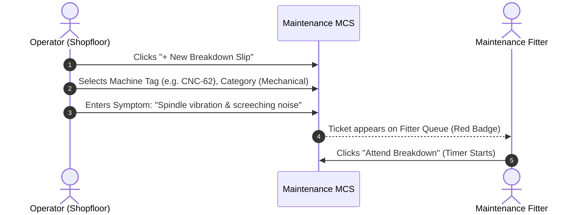
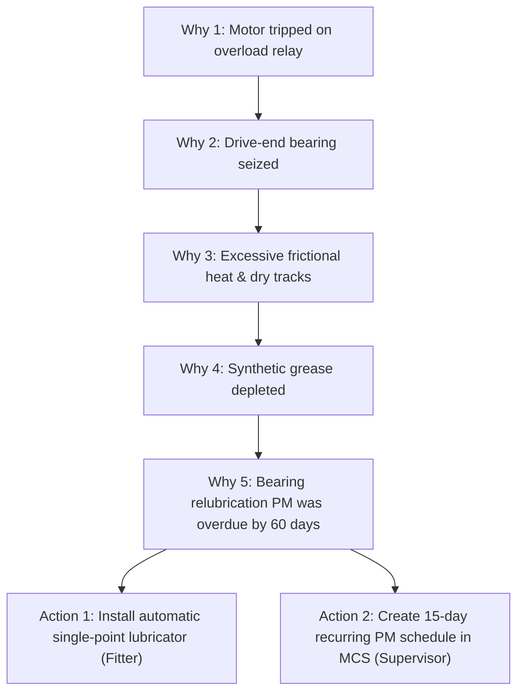

# Maintenance Reliability MCS — Factory Training Guide & Operational Curriculum

> **Document Version**: 2.0  
> **Target Audience**: Machine Operators, Maintenance Technicians (Fitters/Electricians), Shift Supervisors, Storekeepers, Plant Leadership.  
> **System Access**: [https://maintenance-mcs-1.onrender.com](https://maintenance-mcs-1.onrender.com) (or Cloudflare Pages frontend).

---

## 📚 Curriculum Overview

This training guide is designed to take factory staff from zero to fully certified users in **Maintenance Management & Reliability MCS**. It includes practical scenarios, role-based standard operating procedures (SOPs), hands-on lab drills, and self-assessment checklists.

---

## 🔑 Test Training Accounts & Roles

| Role | Default Email | Default Password | Permission Tier | Primary Responsibilities |
|---|---|---|---|---|
| **Plant Administrator** | `admin@maintenance.local` | `password123` | `ADMIN` | Master data import, user provisioning, system configuration. |
| **Shift Supervisor** | `supervisor@maintenance.local` | `password123` | `MANAGEMENT` | Work order dispatch, PM approval, 5-Why RCA root cause analysis. |
| **Mechanical Fitter** | `fitter@maintenance.local` | `password123` | `TECHNICIAN` | Attend breakdown slips, PM checklist execution, log spares & hours. |
| **Machine Operator** | `operator@maintenance.local` | `password123` | `OPERATOR` | Raise breakdown tickets, observe symptoms, track line status. |

---

## 📖 Module 1: System Basics & Navigation

### 1.1 First-Time Login
1. Open Google Chrome or Edge on mobile, tablet, or desktop.
2. Navigate to your factory portal URL.
3. Enter your email and password provided in the table above.
4. Click **Sign In**.

### 1.2 Layout & Navigation
- **Left Sidebar**: Access Dashboard, Breakdowns, PM Schedules, Predictive Maintenance, Spares, RCA, Knowledge Bank, and Asset Master.
- **Top Header**:
  - **Online / Offline Status Badge**: Green dot = Connected to Cloud; Amber dot = Offline Mode (All changes queue locally and auto-sync when network returns).
  - **Logged-in User Badge**: Displays your name and role tier.

---

## 🏭 Module 2: Machine Operator Training

### 2.1 Learning Objectives
- Identify when a breakdown slip must be raised.
- Accurately select the machine code, failure category, and symptom.
- Monitor attendance and repair status in real time.

### 2.2 Hands-On Drill: Raising a Breakdown Slip

#### Step-by-Step Instructions:
1. From the left sidebar, click **Breakdowns**.
2. Click the blue button **+ Raise Breakdown Slip** at the top right.
3. Fill out the 4 critical fields:
   - **Machine Tag**: Search or select from dropdown (e.g. `CNC-62`, `EXT-001`, `PUMP-001`).
   - **Failure Category**: Choose `Mechanical`, `Electrical`, `Utility`, or `Instrumentation`.
   - **Occurred At**: Default is current time (or backdate if reporting post-containment).
   - **Symptom / Problem Description**: Be specific (e.g., *"Suction pressure dropped from 4.2 bar to 1.1 bar, seal leaking oil"*).
4. Click **Submit Breakdown Slip**.
5. The status badge will show **`OPEN` (Amber)** until a technician attends the call.

---

## 🔧 Module 3: Maintenance Technician Training (Fitters & Electricians)

### 3.1 Learning Objectives
- Attend open breakdown slips and calculate exact MTTR response times.
- Complete PM and Predictive inspection checklists.
- Log consumed spare parts and labor hours accurately for cost tracking.
- Work seamlessly in areas with poor Wi-Fi (Offline-First Cache).

### 3.2 Workflow A: Attending & Closing a Breakdown
1. Open **Breakdowns** and locate your assigned machine or ticket.
2. Click on the ticket row to open **Breakdown Detail**.
3. Click **Attend Breakdown**:
   - The system timestamps your arrival (`attendedAt`).
   - Status switches to **`IN_PROGRESS` (Blue)**.
4. Execute mechanical/electrical containment and repairs.
5. In the **Completion Details** section:
   - **Action Taken**: Write what you fixed (e.g., *"Replaced drive-end bearing 6205-2RS, realigned pulley, verified runout"*).
   - **Spare Parts Used**: Select item code (e.g. `BRG-6205`), enter quantity `1`.
   - **Manpower Hours**: Enter actual time spent (e.g., `2.5` hours).
6. Click **Close Breakdown Slip**:
   - Restoration timestamp (`restoredAt`) is automatically captured.
   - Downtime minutes and MTTR are calculated instantly.

### 3.3 Workflow B: Executing a Preventive Maintenance (PM) Checklist
1. From sidebar, click **PM Schedules** or **PM Work Orders**.
2. Open a scheduled work order with status **`SCHEDULED`**.
3. Click **Start PM Checklist**.
4. Inspect each checkpoint item:
   - Click **PASS (Green)** if the condition is normal.
   - Click **FAIL (Red)** if inspection reveals wear, loose hardware, or abnormal heat.
   - Enter numeric readings if requested (e.g. `Insulation Resistance: 150 MΩ`).
5. Click **Submit & Complete PM**.

---

## 🔍 Module 4: Shift Supervisor & Reliability Engineer Training

### 4.1 Learning Objectives
- Conduct digital 5-Why and Fishbone (Ishikawa) Root Cause Analyses.
- Assign corrective and preventive action items with hard due dates.
- Review and approve PM schedule deviation requests.

### 4.2 Workflow: Conducting a 5-Why RCA

#### Step-by-Step Instructions:
1. Navigate to **RCA (Root Cause Analysis)** from the sidebar.
2. Click **+ New RCA Record** and link the breakdown work order.
3. Select Method: **5-Why Analysis**.
4. Populate the 5 sequential investigation steps.
5. State the clear **Root Cause Statement**.
6. Add **Action Items**:
   - Specify **Type**: `Corrective` (immediate fix) or `Preventive` (systemic prevention).
   - Assign **Owner**: Technician or Supervisor.
   - Set **Due Date**: Future calendar deadline.
7. Click **Mark Final**.

---

## 📦 Module 5: Storekeeper & Spare Parts Management

### 5.1 Learning Objectives
- Maintain the digital Spare Parts Master catalog.
- Audit spare parts consumption by machine and failure category.
- Export inventory consumption spreadsheets for plant purchasing.

### 5.2 Key Actions:
- **Add New Spare Part**: Go to **Spares** $\rightarrow$ Click **+ Add Spare Part** $\rightarrow$ Provide `Item Code` (e.g. `SEAL-MS35`), `Name`, `Unit`, and `Unit Cost`.
- **Export Inventory Report**: Click **Export** $\rightarrow$ Select `XLSX` or `PDF` to download the live consumption report including total quantity consumed and total cost.
- **Bulk Import**: Click **Import** $\rightarrow$ Choose `.xlsx` template matching columns: `Item Code`, `Name`, `Unit`, `Unit Cost`.

---

## 📊 Module 6: Plant Leadership & KPI Dashboard

### 6.1 Learning Objectives
- Interpret overall plant MTTR, MTBF, and Machine Availability.
- Identify repeat offenders using the **Downtime Pareto Chart**.
- Analyze maintenance expenditure (Manpower Labor vs Spare Parts).

### 6.2 Key Metrics Reference:
| Metric | Healthy Benchmark | Formula | What Action to Take if Off-Target |
|---|---|---|---|
| **MTTR** | $< 120$ mins | $\frac{\text{Total Downtime}}{\text{Breakdown Count}}$ | Standardize troubleshooting playbooks, pre-kit fast-moving spares. |
| **MTBF** | $> 60$ days | $\frac{\text{Operating Days Between Breakdowns}}{\text{Breakdown Count} - 1}$ | Improve PM checklist compliance and condition monitoring frequency. |
| **PM Compliance** | $> 95\%$ | $\frac{\text{Closed PMs}}{\text{Total Scheduled PMs}}$ | Rebalance technician shift workloads; eliminate overdue deviations. |
| **RCA Closure Rate** | $> 90\%$ | $\frac{\text{Done + Verified Actions}}{\text{Total Action Items}}$ | Review weekly overdue action tracker in morning production meetings. |

---

## 📱 Module 7: Offline-First Operation (Shopfloor Wi-Fi Loss)

Maintenance MCS features automated offline caching:
1. **Zero Data Loss**: When working in basement pump rooms or metal-shielded electrical switchgear rooms where Wi-Fi drops, continue filling checklists normally.
2. **Local FIFO Queue**: Work order updates and checklist responses are queued in device storage.
3. **Automatic Cloud Sync**: The moment the device returns to Wi-Fi/4G coverage, the top-bar badge turns green and synchronizes all queued records with Supabase.

---

## ✅ Factory Certification Quiz & Practical Exam

### Practical Assessment (Pass Mark: 100%)
- [ ] **Task 1**: Log in as `operator@maintenance.local` and raise a breakdown slip for machine `CNC-62`.
- [ ] **Task 2**: Log in as `fitter@maintenance.local`, attend the ticket, record 1x `BRG-6205` spare part, 2 hours labor, and close the slip.
- [ ] **Task 3**: Log in as `supervisor@maintenance.local`, verify MTTR update on the **KPI Dashboard**, and create a 5-Why RCA for the breakdown.
- [ ] **Task 4**: Export the **Machine Master** and **Spare Parts Inventory** to Excel.

---
*Maintenance Management & Reliability MCS Training Department*
