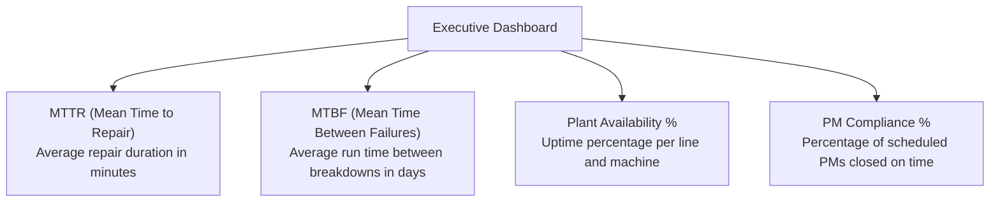

# Maintenance Reliability MCS — Complete User & Operations Guide

A comprehensive, role-based user manual for shop floor operators, maintenance fitters, supervisors, and plant leadership.

---

## Table of Contents
1. [System Access & Default Credentials](#1-system-access--default-credentials)
2. [Shift Operator Guide (Breakdown Reporting)](#2-shift-operator-guide-breakdown-reporting)
3. [Technician & Fitter Guide (Execution & Spares Logging)](#3-technician--fitter-guide-execution--spares-logging)
4. [Supervisor Guide (Work Orders, PM Schedules & 5-Why RCA)](#4-supervisor-guide-work-orders-pm-schedules--5-why-rca)
5. [Inventory & Spare Parts Usage Guide](#5-inventory--spare-parts-usage-guide)
6. [Machine Knowledge Bank Guide](#6-machine-knowledge-bank-guide)
7. [Plant Leadership Guide (Dashboard & KPIs)](#7-plant-leadership-guide-dashboard--kpis)
8. [Master Data Import & Export Guide](#8-master-data-import--export-guide)

---

## 1. System Access & Default Credentials

### Web & Mobile URL:
- **Cloudflare Live App**: `https://your-app.pages.dev` (Or local `http://localhost:5173`)

### Default Role Accounts:
| Role | Email | Password | Primary Permissions |
|---|---|---|---|
| **Admin** | `admin@maintenance.local` | `password123` | Full plant configuration, Master data, User roles |
| **Plant Head** | `head@maintenance.local` | `password123` | Executive KPI analytics, Audit exports, RCA review |
| **Supervisor** | `supervisor@maintenance.local` | `password123` | Work order dispatch, PM schedules, 5-Why RCA, Deviations |
| **Mechanical Fitter** | `fitter@maintenance.local` | `password123` | Breakdown attend, PM checklists, Spare logging |
| **Electrician** | `electrician@maintenance.local` | `password123` | Electrical breakdown attend, Motor audits |
| **Shift Operator** | `operator@maintenance.local` | `password123` | Instant breakdown ticket submission |

---

## 2. Shift Operator Guide (Breakdown Reporting)


### How to Report a Machine Failure (< 30 Seconds):
1. Open the app on your smartphone, tablet, or shop floor PC.
2. Tap **Breakdown Slips** in the navigation menu.
3. Click the blue **"+ Report Breakdown"** button.
4. Fill in 3 simple fields:
   - **Machine**: Select machine tag (e.g. `PUMP-001 — Cooling Water Pump 1`).
   - **Failure Category**: Select `Mechanical`, `Electrical`, `Utility`, or `Instrumentation`.
   - **Observed Symptom**: Describe what happened (e.g. *"Heavy vibration, smoking motor, abnormal grinding noise"*).
5. Click **"Submit Breakdown"**.
6. System captures exact breakdown timestamp (`occurredAt`) and broadcasts ticket to maintenance team.

---

## 3. Technician & Fitter Guide (Execution & Spares Logging)

### Step 1: Attend the Breakdown
1. Open **Breakdown Slips** or **Open Orders** page.
2. Tap on the open breakdown ticket.
3. Click **"Attend"** button:
   - System records your response time (`attendedAt`).
   - Status changes from `OPEN` → `ATTENDED`.

### Step 2: Check AI Suggestions & Knowledge Bank
1. Read the **💡 AI Suggestion Banner** at top of page:
   - Shows what root causes and spare parts resolved this failure on this machine previously.
2. If needed, click **"Machine SOPs & Playbooks"** to view standard troubleshooting steps.

### Step 3: Log Consumed Spare Parts
1. Under **Spare Parts Used**, click **"+ Add Spare Part"**.
2. Select part from catalog (e.g. `BRG-6205 — Ball Bearing 6205`) or type ad-hoc description.
3. Enter **Quantity Used** (e.g. `2 pcs`).
4. Repeat for any seals, lubricants, belts, or fuses consumed during repair.

### Step 4: Close Ticket
1. Enter **Action Taken** (e.g. *"Replaced damaged drive end bearing 6205 and re-aligned coupling"*).
2. Click **"Complete Breakdown"**.
3. System logs `restoredAt`, calculates downtime minutes, and updates inventory counts.

---

## 4. Supervisor Guide (Work Orders, PM Schedules & 5-Why RCA)

### A. Open Orders Board
- Go to **Open Orders** in sidebar.
- View Kanban board of all ongoing repairs across plant lines.
- Click **"Assign"** to assign specific fitters/electricians based on shift workload.

### B. Preventive Maintenance (PM) Schedules
1. Go to **Preventive Maintenance Schedule**.
2. Click **"New Schedule"**:
   - Machine: Pick machine (e.g. `MTR-102`).
   - Interval: `7 days`, `30 days`, `90 days`, etc.
   - Lead Time: `3 days` (Generates work order 3 days in advance).
   - Checklist: Attach pre-configured PM checklist template.
3. System automatically triggers recurring inspections.

### C. 5-Why Root Cause Analysis (RCA)
For major or recurring breakdowns:
1. Go to **RCA Sheet** (or click "Conduct RCA" on closed breakdown).
2. Fill 5-Why iterative diagnostic:
   - **Why 1**: Why did pump overheat? *(Bearing jammed)*
   - **Why 2**: Why did bearing jam? *(Loss of lubrication)*
   - **Why 3**: Why was lubrication lost? *(Seal degraded)*
   - **Why 4**: Why did seal degrade? *(Contaminated fluid)*
   - **Why 5 (Root Cause)**: Why was fluid contaminated? *(Suction strainer was missing)*
3. Add **Action Items** with owner name and completion due date.
4. Track action closure on **RCA Tracker** page.

---

## 5. Inventory & Spare Parts Usage Guide

**Page**: **Inventory & Spare Usage**

### Key Columns Explained:
- **`ITEM CODE`**: Part SKU / Catalog code.
- **`SPARE PART NAME`**: Full descriptive specification.
- **`TIMES USED (FREQUENCY)`**: How many distinct work orders consumed this part.
- **`TOTAL QTY USED`**: Total units consumed (e.g. `24 pcs`, `150 ltr`).
- **`TYPE BREAKDOWN`**: Consumption breakdown (`X BD` Breakdowns, `Y PM` Preventive, `Z PdM` Predictive).
- **`LAST USED`**: Date part was last logged on shop floor.

### View Work Order History:
- Click **"View History (X)"** on any spare part to open an audit log modal showing every machine, work order number, and technician that consumed the part.

### Export to Excel:
- Click **"Export to Excel"** in top right to download full consumption spreadsheet for stores and procurement.

---

## 6. Machine Knowledge Bank Guide

**Page**: **Knowledge Bank** (or machine detail tabs under **Assets**)

### Three Core Knowledge Repositories:
1. **SOPs & Manuals**: PDF machine manuals, single-point lessons (SPL), wiring diagrams, and P&IDs.
2. **Machine Operational Baselines**: Nominal, Minimum, and Maximum safe operating bounds (e.g. Motor Current: 15–25A, Vibration: <4.5 mm/s, Oil Pressure: 3–5 bar).
3. **Troubleshooting Playbooks**: Step-by-step diagnostic trees (Symptoms → Possible Causes → Verification Steps → Corrective Remedies).

---

## 7. Plant Leadership Guide (Dashboard & KPIs)

**Page**: **Dashboard**



### Visual Heatmaps:
- **Breakdown Heatmap**: Highlights problem machines in Red/Amber while healthy machines remain transparent.
- **Preventive Heatmap**: Color-coded matrix of PM compliance across plant lines.
- **Predictive Heatmap**: Real-time condition status (Normal / Warning / Critical threshold breaches).

---

## 8. Master Data Import & Export Guide

### "Export First" Technique for Bulk Uploads:
1. Open target page (**Assets**, **Spare Parts**, or **Users**).
2. Click **"Export Excel"** (`.xlsx`) to get the exact header template.
3. Fill data in rows below headers.
4. Click **"Import Excel"** to bulk-ingest rows in < 3 seconds.

#### Asset Import Format:
```csv
Machine Code,Machine Name,Category,Criticality,Line
PUMP-001,Cooling Water Pump 1,Pump,HIGH,Line 1
MTR-102,Extruder Main Drive Motor,Motor,CRITICAL,Line 1
CMP-004,Air Compressor 4,Compressor,MEDIUM,Utility Area
```

#### Spare Part Import Format:
```csv
Item Code,Name,Unit,UnitCost
BRG-6205,Deep Groove Ball Bearing 6205-2RS,pcs,45.00
SEAL-MS35,Mechanical Shaft Seal 35mm,pcs,120.00
OIL-VG46,Hydraulic Oil ISO VG 46,ltr,18.50
```

---

### Need Assistance?
Contact your Plant System Administrator or submit a support ticket.
